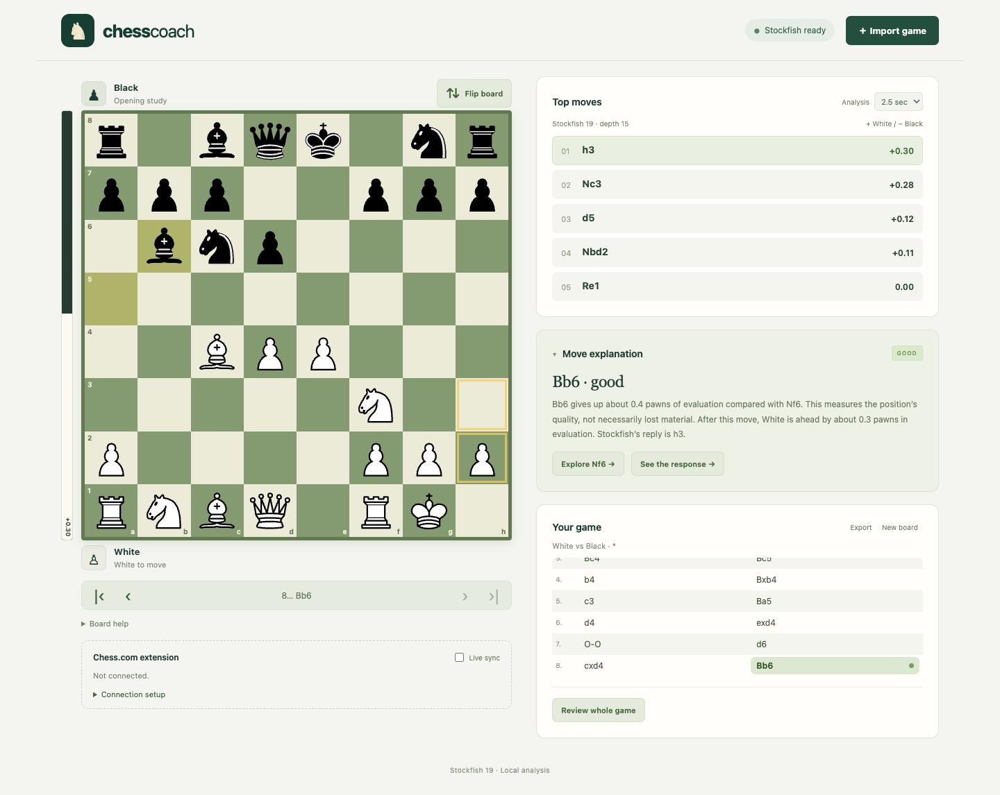

# Chess Coach

[](https://github.com/Max-Gulda/chess-coach/actions/workflows/ci.yml)

A local chess analysis app for understanding your moves. Explore a position, compare Stockfish's best continuations, and review the moments that changed a game.



## Features

- **Interactive board:** legal moves, drag and drop, promotion, board flipping, and keyboard navigation.
- **Five engine lines:** Stockfish 19 evaluations with continuations you can play through.
- **Move explanations:** evaluation changes, stronger alternatives, and concrete replies from the engine line.
- **Game review:** approximate move grades and markers for positions worth revisiting.
- **PGN and FEN:** import games or positions, export PGN, and restore your latest game from browser storage.
- **Optional Chess.com connection:** a browser extension follows a visible bot game or practice board.

## Getting started

Install [Node.js](https://nodejs.org/) **22.12 or newer** and Git. The project includes an `.nvmrc` for Node.js 24.

```sh
git clone https://github.com/Max-Gulda/chess-coach.git
cd chess-coach
npm ci
npm run dev
```

Open **<http://127.0.0.1:4173>**. The same commands work from any checkout location on macOS, Windows, or Linux. Stop the foreground server with `Ctrl+C`.

Installation prepares the local Stockfish files and builds the optional extension. No API key or account is needed for analysis. After installation, ordinary board analysis works offline; the local server must still be running.

For later launches, `npm start` starts the app in the background and opens your default browser. On macOS, you can also double-click `Start Chess Coach.command` inside the project folder.

## Using the app

Import a PGN game or a FEN position, or make moves directly on the board. Use the move list or arrow keys to revisit positions. Click a suggested move to explore its continuation, then choose **Return to game**.

Scores always use White's perspective: **+ favors White**, **− favors Black**, and **M indicates mate**. They estimate positional advantage in pawn units, not necessarily material. Expand **Move explanation** for a comparison with Stockfish's recommendation, or run **Review whole game** to mark costly moves.

Playing a different move earlier in the game replaces its later moves after confirmation. Export the original first if you want to keep both versions.

### Connect a Chess.com board

The optional extension supports Chromium browsers. In Chrome, open `chrome://extensions`, enable **Developer mode**, and load the generated **`extension/dist` folder inside your checkout**. Reload the Chess.com tab, start syncing from the extension popup, and enable **Live sync** in Chess Coach.

See the [extension guide](extension/README.md) for setup, permissions, and troubleshooting. The app and extension use local port **4173**; a static copy of the production build does not provide the sync endpoint.

Use engine assistance only where permitted, such as bot games, practice, and postgame analysis.

## How it works

The interface uses plain JavaScript and CSS, with [chess.js](https://github.com/jhlywa/chess.js) handling legal moves and game notation. Stockfish runs in a browser worker and communicates through UCI, keeping engine searches off the UI thread. Analysis requests are serialized and cancelled when the position changes, and results are normalized to White's perspective.

Move explanations compare the evaluations before and after a move and describe concrete events in the engine continuation. The extension reconstructs the visible game through legal move replay and checks that it matches the displayed board before sending it to the loopback server.

```text
src/          Board interface, Stockfish adapter, and explanation logic
extension/    Optional Chess.com content script, popup, and background worker
scripts/      Asset preparation, launcher, build helpers, and browser checks
tests/        Engine and analysis regression checks
public/       Piece artwork and locally prepared engine assets
```

Games are stored in the current browser's local storage. Engine analysis stays on your computer. The extension sends only the visible game position and moves to the local app; it does not request your password or play moves.

## Development

| Command                  | Purpose                                            |
| ------------------------ | -------------------------------------------------- |
| `npm run dev`            | Run the local app in the foreground                |
| `npm start`              | Start the local app and open the default browser   |
| `npm run setup`          | Prepare engine assets and rebuild the extension    |
| `npm run extension`      | Rebuild only the extension bundle                  |
| `npm test`               | Run engine and analysis checks                     |
| `npm run test:browser`   | Exercise the app with a real browser and Stockfish |
| `npm run test:extension` | Verify move replay and sync using a local fixture  |
| `npm run build`          | Create the production build in `dist`              |
| `npm run format:check`   | Check source formatting                            |

Install the browser used by the integration checks once:

```sh
npx playwright install chromium
npm test
npm run test:browser
npm run test:extension
npm run build
```

On Linux, Playwright may also require system browser dependencies; use `npx playwright install --with-deps chromium` when needed. Browser checks start an isolated local server and do not connect to an online game. GitHub Actions runs formatting, unit checks, browser checks, extension checks, and the production build.

Generated engine binaries, extension bundles, dependencies, logs, and build output are excluded from Git. `npm ci` recreates the required assets from the locked dependencies.

## Limitations

Move grades are heuristics from short engine searches, and explanations describe the returned line rather than a complete strategic assessment. Increase analysis time for difficult positions. The app imports one PGN game at a time and retains one current game in browser storage; export PGN for a lasting collection.

The extension needs a complete visible move history beginning at the normal starting position. Custom positions, ambiguous repetitions, or Chess.com layout changes may require PGN/FEN import. It has been checked against a real Chess.com guest bot game; other site layouts are not guaranteed.

## License and credits

Chess Coach is licensed under [GPL-3.0-or-later](LICENSE). It uses Stockfish.js, chess.js, and Colin M. L. Burnett's Cburnett piece artwork. See [third-party notices](THIRD_PARTY_NOTICES.md) for versions, upstream sources, and licenses.
